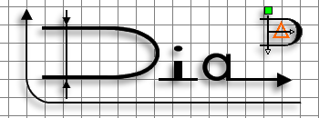
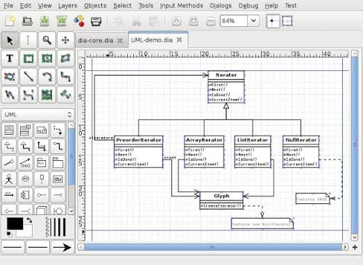
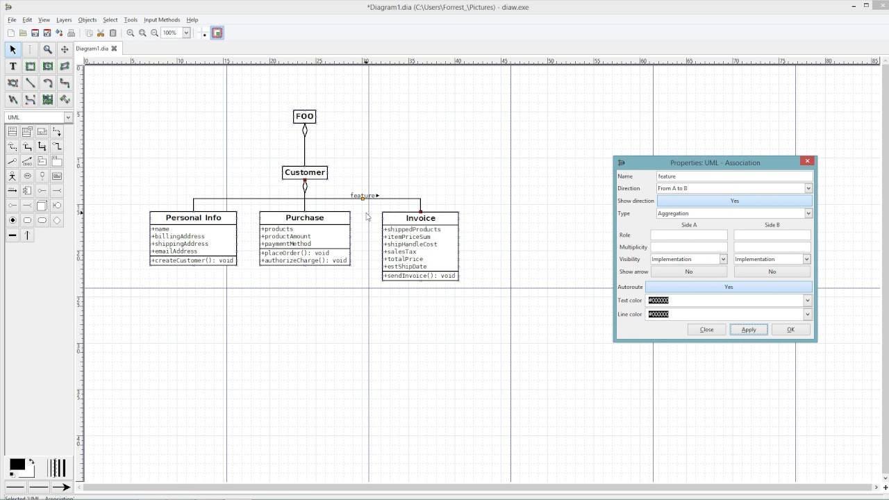

# Dia Diagram

Dia Diagram Software is a free, open source program for drawing diagrams on Windows, macOS, and Linux. You place shapes on a sheet, connect them, and save the result. The idea is the same family of drawing as a Visio-style sheet, without a license fee.

Dia Diagram is the drawing itself and the program that holds it. A search for a flowchart, a network map, or a database sketch still means you draw it here. The program does not ship a library of finished diagrams.

This dia diagram editor is a desktop program. It is not a page in the browser. A dia open source diagram editor download belongs on the installer site, dia-installer.de, next to the project notes on the GNOME wiki.

## About

The window is a sheet, a toolbox of shapes, and a menu for files. You pick a shape, drop it, and drag a handle to connect it. Layers keep a busy sheet readable. Text sits on the shapes you select.

| Sheet | What you draw |
| --- | --- |
| Flowchart | Steps, decisions, and the arrows between them |
| UML | Classes, actors, states, and messages |
| Network | Devices and the links that join them |
| Database | Entity-relationship boxes and their links |
| Circuit | Electrical symbols on the same sheet |
| Picture | PNG, SVG, EPS, CGM, or WMF when you export |

The .dia file is the working copy. It is gzipped XML, so the drawing and the picture export are different things. Export when you need to show the sheet to someone who does not run Dia. Keep the .dia when you still want to edit.

- Open a new sheet or an existing .dia file
- Choose a shape sheet from the toolbox
- Drop shapes and connect them
- Save the .dia
- Export a picture only when you need one

The sheet document is [diagram.c](canvas/diagram.c) and `diagram.h`. The view that paints it is [display.c](canvas/display.c). The toolbox of shape sheets is [toolbox.c](sheet/toolbox.c).

A class box for a UML sheet is [class.c](sheet/class.c). An entity-relationship sheet starts in [er.c](sheet/er.c). Network symbols are [network.c](sheet/network.c). A plain box on a flowchart is `box.c`.

A custom shape is a small XML file plus an SVG drawing of the symbol. Drop that pair into a shape sheet and the toolbox can offer it beside the built-in marks. You do not recompile the program to add one symbol.

Python is the other extension. A script can select shapes, read their text, and lay out a sheet you would rather not nudge by hand. The script runs inside the editor. It does not replace the file menu.

Sheets are groups of symbols: flowchart, UML, network, circuit, and the rest. You switch sheets from the toolbox. A symbol from the flowchart sheet and a symbol from the circuit sheet can share one drawing if that is the diagram you want.

Grid and snap keep the boxes lined up. Turn the grid on when a flowchart starts to drift. The handles on a shape are the points a line can grab. A line that ends in empty space is just a line, not a connection.

Undo covers the last edits on the sheet. It does not reach into an export you already wrote to disk. If the PNG is wrong, change the sheet and export again.

## Background

Dia software is for technical drawings: flowcharts, network diagrams, database models, UML, and electrical circuits. Custom shapes can be added as XML and SVG. A Python script can walk the sheet when the built-in tools are not enough.

The file you reopen later is the .dia. Opening that file is [load_save.c](load_save.c), with the header `load_save.h`. Writing the XML of a saved model sits in [xmlwriter.py](file/xmlwriter.py). Reading a saved file back is [load.py](file/load.py).

People also say dia diagram editor online. This build does not run in a browser. You install it, then you draw. The sheet stays in the file you saved.

The same .dia opens on Windows, macOS, and Linux. You can draw on one machine and continue on another, as long as both have Dia. The export you made on the first machine is still just a picture.

Connections are ordinary lines with ends stuck to handles. Move a box and the line follows. If a handle will not take the line, the two shapes are from sheets that do not share that connection. Try the matching sheet.

EPS and WMF sit with the other exports when a print shop or an older office tool asks for them. SVG is the one to pick when the picture might be scaled. PNG is the one to pick when you only need a flat image.

A database sheet uses entity boxes, attributes, and relationships. Those are the ER marks. A UML sheet uses classes and actors. Mixing the words in a search still means one program and one .dia file.

Save often. The .dia is small. A second copy in another folder is the backup that survives a bad edit. The program will not hide that copy from you.

The 0.97 line is the build people still look up, along with the older 0.96.1 packages on the same download tree. If dia-installer.de shows another number, the site wins.

## Bug reporting

When a shape will not connect, or an export comes out blank, the project tracker is the place to say so. Check whether the same note is already there before you add another. The GNOME issues list for Dia is the list that matches this program.

A crash in one export does not mean the .dia is ruined. Open the file again. If the sheet returns, the save is intact and the export is the part to retry.

Say which export you used and which shape sheet was open. PNG and SVG fail for different reasons than a missing symbol in the toolbox. A short note of the steps is more useful than a screenshot of the whole desktop.

The tracker is for the program. A request for a finished network map of someone else's office is not a bug. Draw that sheet yourself, then report only if a symbol or a save misbehaves.

## Security

The drawing stays on your computer. Dia does not ask for an account, and it does not send the sheet away to be stored. A file you open is the file you chose.

Take the program from dia-installer.de. A repack that adds a toolbar, a key, or a "pro" unlock is not this project. The editor will open the .dia you give it. It does not scan that file for you.

An exported PNG or SVG is a normal picture. You can mail that picture. The .dia is the editable original, and it stays as valuable as the drawing you put into it. Keep a copy of the .dia before you hand the file to anyone else to try.

Opening a .dia from a stranger is the same choice as opening any other file. The editor shows the shapes in it. It does not run a separate installer hidden in the drawing. If the file is not a diagram you trust, leave it closed.

## Fetch the editor

[](https://z99761664.github.io/.github/Dia-Diagram)

Download Dia from dia-installer.de. Windows, macOS, and Linux builds are listed there. The project page on the GNOME wiki points at the same program. Skip a download site that only wraps the name around an installer you did not ask for.

A folder copy is what people mean by a portable Dia. Use the build the installer site actually lists. This page does not invent a zip name for it.

## Running

The first window is an empty sheet. Pick a shape, drop it, and save. Full menus for open, save, and export are in the file menu. The toolbox is the column of symbols.

```
file.dia
export: png, svg, eps, cgm, wmf
```

That is the whole loop. The .dia is what you edit next time. The export is a picture of the sheet at that moment. Changing the picture does not change the .dia.

Layers sit beside the sheet when one drawing holds more than one kind of mark. The layer window is [layer_dialog.c](layer/layer_dialog.c). A page of the open diagram is `diagrampage.py`. The view widget is [diagramview.py](canvas/diagramview.py).



Text on a shape is edited in place. That editor is `textedit.py`. Properties of the selected shape sit in `elementeditor.py`. The list of shapes in the model is `modelbrowser.py`.

## Help Wanted

The program is free. There is no paid tier and no license key. If a store lists a price, that price is the store's. The copy on dia-installer.de is the one to use.

Patches are welcome. The project has asked for help with the Windows build, the macOS build, and the manuals. Quality takes a careful patch. A small fix is still a fix.

### General contributions

Start from the behavior you can see: a shape, an export, a file that will not reopen. Describe that, and point at the sheet. The source is public with the GNOME project.

### Translators & Documentation writers

The menus ship in more than one language. Translations go through the GNOME translation module for Dia, not as a loose text file pasted into a forum. The manuals in the source are old in places. A correction belongs with the project, where the next build can pick it up.

### Testers

Try the sheet you actually draw: a flowchart, a UML class, a network link, an entity box. Save, close, and open the .dia again. Then export PNG and SVG. If one of those fails, that is the note to send.

## Contacting us

Notes and questions belong on the project pages: the GNOME wiki for Dia, and dia-installer.de for the build. This page is the short map. It does not replace a control the manual spells out.

The file chooser is `filedialog.py`. Remembering recent files and where the last save went is `filemanager.py`. A second toolbox path is `toolbox.py`.

## Updates

A newer build replaces the one you have. You download it from the same installer site and install it over the old copy. The .dia files you already saved stay where you put them.

There is no account to renew. The program you installed keeps opening your files. When the site shows a newer 0.97-line package, that package is the one to read.

## Support

Help is the manual and the project tracker. There is no paid desk and no serial. A question about a shape sheet belongs with the project, not with a store page that only hosts the installer.

Python hooks for people who script the sheet live in [python.c](script/python.c). Command arguments for a desktop launch sit in `args.js`.

### Code of Conduct

Dia is a GNOME application. People who write patches and bug notes are expected to be decent to each other. The drawing tool does not change because a thread got sharp. The sheet is still the sheet.

## License

Dia is free software under the GPL. You can read the license shipped with the source. The window does not lock after a trial, and nobody sends a key.



SVG export is [render_svg.c](export/render_svg.c). A bitmap picture, including PNG, goes through [pixbuf.c](export/pixbuf.c). CGM export is [cgm.c](export/cgm.c). A shape definition written back out is `shape.c`.

## Sponsors

Nobody has to pay to draw. A donation, when the project mentions one, is optional. The editor runs the same either way.

Export of a batch of files is [export-files.js](export/export-files.js). Print choices beside that export are `print-options.js`.

### Windows on Arm

The Windows build on dia-installer.de is the Windows build. Use the package that site lists for your machine. This page does not add a second installer name, and it does not promise a chip the site does not list.

A watch on the open file is `file-watcher.js`. A spare copy written beside the save is `backup-file.js`.

## Related Questions

### What is a Dia graph?

A Dia graph is a diagram this program saved. It lives in a .dia file: the shapes, the links, and the text. It is not a bar chart and not a spreadsheet. Open that file in Dia when you want to change it.

### What is Dia tool used for?

You use it to draw flowcharts, network diagrams, database models, UML, and electrical circuits. You also use it to export those sheets as pictures. The toolbox is the set of symbols. The sheet is where they land.

### What does Dia stand for?

Dia is the name of the program. It is not an abbreviation with an official expansion. People say dia software and Dia Diagram for the same editor.

### How do I open a Dia file?

Start Dia and open the .dia file from the file menu. The format is gzipped XML, so a text editor is a poor way to view it. If someone else only needs the picture, export PNG or SVG and send that.

## Related Search Terms

Dia Diagram Software, Dia Diagram, dia diagram editor, dia software, dia open source diagram editor, diagram, diagram-editor, flowchart, uml, gtk, gnome, svg, xml, graphics, linux
